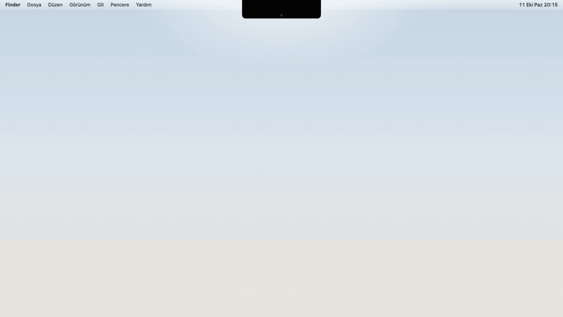

# Notch Downloads

MacBook'un çentiğinin (notch) altına yerleşen, **son 5 indirilen dosyayı** gösteren
küçük bir macOS uygulaması.



▶️ [Demo videosunu izle (MP4, 22 sn)](https://github.com/mslmyilmaz5/mac-last-downloads/releases/download/v1.1.0/NotchDownloads-demo.mp4)

## İndir

Hazır uygulama: **[Son sürümü indir](https://github.com/mslmyilmaz5/mac-last-downloads/releases/latest)**

| Dosya | Link |
| --- | --- |
| DMG (önerilen) | [NotchDownloads.dmg](https://github.com/mslmyilmaz5/mac-last-downloads/releases/latest/download/NotchDownloads.dmg) |
| ZIP | [NotchDownloads.zip](https://github.com/mslmyilmaz5/mac-last-downloads/releases/latest/download/NotchDownloads.zip) |

**Kurulum:** DMG/ZIP'i açın, uygulamayı `/Applications` klasörüne sürükleyin.
İlk açılışta **sağ tık → Aç** deyin. "Bozuk olduğu için açılamıyor" uyarısı
çıkarsa Terminal'e şunu yazın:

```sh
xattr -cr /Applications/NotchDownloads.app
```

(Uygulama Apple Developer ID ile imzalanmadığı için Gatekeeper uyarısı normaldir.)
Ardından gelen İndirilenler klasörü iznini **İzin Ver** ile onaylayın.

## Özellikler

- **Çentik altında ince bir "çene"**: Boştayken çentiğin doğal bir uzantısı gibi durur,
  fareyi üzerine getirince (veya tıklayınca) genişler.
- **Anlık bildirim**: Yeni bir dosya indiğinde çentiğin altında birkaç saniyelik
  önizleme bandı belirir.
- **Son 5 dosya**: İndirilme tarihine göre sıralı, gerçek dosya ikonlarıyla.
- **Sürükle & bırak**: Satırı — ya da yeni dosya bildirimini, listeyi açmadan —
  tutup Finder'a, terminale veya herhangi bir uygulamaya sürükleyebilirsiniz.
- **Hızlı aksiyonlar**: Satırın üzerine gelince Finder'da Göster, Kopyala, Paylaş,
  Çöp Kutusuna Taşı düğmeleri belirir. Sağ tık menüsünde de tüm aksiyonlar vardır.
- **Yarım indirmeleri gizler**: `.download`, `.crdownload`, `.part` gibi devam eden
  indirmeler listede görünmez; dosya tamamlanınca belirir.
- **Ekran görüntüleri**: macOS'un ekran görüntüsü klasörü (varsayılan Masaüstü) de izlenir;
  yalnızca ekran görüntüsü/kaydı dosyaları listeye girer. Menüden **"Ekran Görüntülerini
  Anında Göster"** açılırsa sistemin yüzen küçük resmi kapatılır ve görüntü çekildiği anda
  çentikte belirir. (Masaüstü izni de istenir.)
- **Menü çubuğu ikonu**: Paneli açma, oturum açılışında başlatma, çıkış.
- Çentiksiz ekranlarda (harici monitör) menü çubuğunun altına ortalanmış olarak çalışır.

## Gereksinimler

- macOS 13 Ventura veya üzeri
- Apple Silicon (M1 ve sonrası) — hazır sürüm yalnızca `arm64` için derlenir
- Swift toolchain (Xcode Command Line Tools yeterli): `xcode-select --install`

## Çalıştırma

```sh
make run
```

Bu komut uygulamayı derler, `dist/NotchDownloads.app` paketini oluşturur ve başlatır.

İlk çalıştırmada macOS **"NotchDownloads, İndirilenler klasörünüzdeki dosyalara
erişmek istiyor"** diye sorar — **İzin Ver** deyin. İzin reddedilirse panel içinden
"Sistem Ayarları'nı Aç" düğmesiyle izin verebilirsiniz.

### Geliştirme sırasında izin döngüsünden kaçınma

Uygulama ad-hoc imzalı olduğu için her yeniden derlemede macOS izni sıfırlayabilir.
Geliştirme yaparken bunun yerine:

```sh
make dev
```

ile terminalden çalıştırın — uygulama, terminalinizin (Terminal/iTerm) zaten sahip
olduğu İndirilenler iznini miras alır ve her derlemede yeniden sormaz.

## Kurulum

```sh
make install   # /Applications altına kopyalar
```

Ardından menü çubuğu ikonundan **"Oturum Açılışında Başlat"** seçeneğini açın.

## Kaldırma

```sh
make uninstall
```

## Mimari

| Dosya | Görev |
| --- | --- |
| `DownloadsMonitor.swift` | `~/Downloads` klasörünü `DispatchSource` (vnode) ile izler, son 5 dosyayı çıkarır |
| `ScreenshotSettings.swift` | Ekran görüntüsü klasörü ve `show-thumbnail` ayarı (`com.apple.screencapture`) |
| `NotchGeometry.swift` | Çentiğin ekran koordinatlarını hesaplar (`auxiliaryTopLeftArea` / `safeAreaInsets`) |
| `NotchViewModel.swift` | UI durumu (çene / bildirim / liste) + dosya aksiyonları |
| `NotchPanelController.swift` | Odak çalmayan `NSPanel`'i çentiğin altına konumlandırır, animasyonları yönetir |
| `Views/` | SwiftUI görünümleri (liste, satır, bildirim bandı) |
| `AppDelegate.swift` | Menü çubuğu ikonu, oturumda başlat (SMAppService) |

Klasör erişimi sandbox'sız çalışır; TCC ("İndirilenler" izni) ilk açılışta sorulur.

## Lisans

[MIT](LICENSE)
